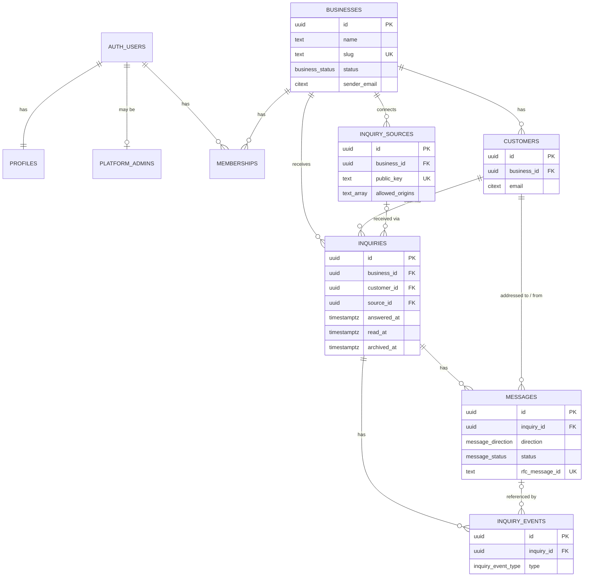

# Flowdesk: Database Schema

| | |
|---|---|
| Database | Supabase Postgres (dev project `zbpimhaqjuabdzjruxjd`; prod project created before launch) |
| Schemas used | `public` (exposed through the Supabase Data API), `private` (internal helpers, not exposed), `auth` and `storage` (managed by Supabase) |
| Related | [PRD.md](PRD.md) (product requirements), [Tech.md](Tech.md) (architecture) |
| Status | Migrated to the dev project on 2026-11-07 (8 migrations in `supabase/migrations/`). Prod not created yet |

This document is the source of truth for the schema. Migrations in `supabase/migrations/` implement it. If the two ever differ, update this document in the same change.

---

## 1. Design principles

1. **Tenant key on every tenant table.** Every table holding business data has a `business_id` column, even when it could be derived through a parent. This keeps access rules simple and fast.
2. **Row Level Security (RLS) everywhere.** RLS is enabled on every table in `public`. Access is granted only by explicit policies. The `anon` role gets nothing; the website intake goes through the server.
3. **Cross-tenant links are impossible.** Child rows reference parents with **composite foreign keys** `(id, business_id)`. For example, an inquiry cannot point at another business's customer.
4. **Status is derived, not stored.** New, Awaiting and Answered are calculated from `created_at` and `answered_at`. No scheduled job is needed.
5. **Writes that must stay consistent go through SQL functions.** Intake, onboarding and status actions run inside one transaction, and their timeline events are written at the same time.
6. **Ready for later.**
   - Messages already have a direction (outbound/inbound) and threading columns.
   - Inquiries have a `reply_token`.
   - Memberships have roles.
   - Businesses have a `pending` status.
7. **Conventions.**
   - Names are `snake_case`; tables are plural.
   - Primary keys are `uuid` with a `gen_random_uuid()` default.
   - Times are `timestamptz` (stored in UTC, displayed in the business timezone).
   - Email addresses are `citext` (case-insensitive).
   - Every mutable table has `created_at` and `updated_at`.

---

## 2. Entity relationship diagram



`rate_limits` stands alone and is not shown.

### Delete behaviour (cascades)
| When this is deleted | These are deleted too | These are kept (link set to null) |
|---|---|---|
| business | memberships, inquiry_sources, customers, inquiries, messages, inquiry_events | — |
| auth user | profile, platform_admins row, memberships | `messages.sent_by`, `inquiry_events.actor_id` |
| customer | all their inquiries, messages and events | — |
| inquiry | its messages and events | — |
| inquiry source | — | `inquiries.source_id` |
| message | events referencing it | — |

Referential cascades are not subject to RLS. Deleting a customer as an owner removes all their data in one statement.

---

## 3. Extensions

| Extension | Schema | Used for |
|---|---|---|
| `citext` | `extensions` | Case-insensitive email columns |
| `pg_trgm` | `extensions` | Fast `ILIKE '%term%'` search on inquiries |
| `pgcrypto` | `extensions` | `gen_random_bytes()` for form keys and reply tokens (enabled by default on Supabase) |

---

## 4. Enum types

| Type | Values | Notes |
|---|---|---|
| `business_status` | `pending`, `active`, `suspended` | `pending` is reserved for future self-registration |
| `membership_role` | `owner`, `member` | MVP uses only `owner` |
| `message_direction` | `outbound`, `inbound` | MVP writes only `outbound` |
| `message_status` | `sending`, `sent`, `failed`, `received` | `received` is for future inbound messages |
| `inquiry_event_type` | `received`, `reply_sent`, `reply_failed`, `marked_answered`, `marked_unanswered`, `archived`, `restored` | Feeds the timeline and the dashboard activity feed |

The derived inquiry status (`new`, `awaiting`, `answered`) is **not** an enum column. It is computed in `inquiries_view` (§6).

---

## 5. Tables

### 5.1 `businesses`
One row per business on the platform.

| Column | Type | Null | Default | Notes |
|---|---|---|---|---|
| `id` | uuid | no | `gen_random_uuid()` | PK |
| `name` | text | no | | 1–200 chars |
| `slug` | text | no | | Unique. Lowercase kebab-case (`^[a-z0-9]+(-[a-z0-9]+)*$`). Used in the default sender address |
| `email` | citext | no | | Business email: new-inquiry notifications, BCC copies, default reply-to |
| `website` | text | yes | | Public website URL (informational) |
| `logo_path` | text | yes | | Object path in the `business-logos` storage bucket |
| `timezone` | text | no | `'UTC'` | IANA name (e.g. `Europe/Berlin`). The app validates it against `Intl.supportedValuesOf('timeZone')` |
| `status` | business_status | no | `'active'` | `suspended` blocks owner access and intake |
| `notify_new_inquiry` | boolean | no | `true` | Email the business on each new inquiry |
| `bcc_replies` | boolean | no | `false` | BCC the business email on every reply |
| `signature` | text | yes | | Plain text, max 1000 chars. `null` = default (owner name + business name) |
| `sender_name` | text | no | | The "From" display name. Defaults to `name` at creation |
| `sender_email` | citext | no | | The "From" address, e.g. `acme@mail.<platform-domain>`. **Admin only** |
| `reply_to_email` | citext | yes | | `null` = use `email` |
| `custom_sending_domain` | text | yes | | A domain verified in Resend for this business. **Admin only**, for reference |
| `created_at` | timestamptz | no | `now()` | |
| `updated_at` | timestamptz | no | `now()` | Trigger-maintained |

Constraints: `unique (slug)`, plus `check` constraints for the name length, slug format and signature length.

### 5.2 `profiles`
Extra data for each auth user. A trigger creates a profile when a user is created.

| Column | Type | Null | Default | Notes |
|---|---|---|---|---|
| `id` | uuid | no | | PK, FK → `auth.users(id)` on delete cascade |
| `full_name` | text | no | `''` | Max 200 chars |
| `created_at` | timestamptz | no | `now()` | |
| `updated_at` | timestamptz | no | `now()` | |

The login email lives in `auth.users.email`. It is not duplicated here.

### 5.3 `platform_admins`
Users with access to `/admin`. No client policies can write to it, so nobody can make themselves an admin. Rows are added manually in the Supabase dashboard (SQL editor).

| Column | Type | Null | Default | Notes |
|---|---|---|---|---|
| `user_id` | uuid | no | | PK, FK → `auth.users(id)` on delete cascade |
| `created_at` | timestamptz | no | `now()` | |

### 5.4 `memberships`
Links users to businesses. Many-to-many is ready for employees later; the MVP UI assumes one business per user.

| Column | Type | Null | Default | Notes |
|---|---|---|---|---|
| `id` | uuid | no | `gen_random_uuid()` | PK |
| `business_id` | uuid | no | | FK → `businesses(id)` on delete cascade |
| `user_id` | uuid | no | | FK → `auth.users(id)` on delete cascade |
| `role` | membership_role | no | `'owner'` | |
| `created_at` | timestamptz | no | `now()` | |

Constraints: `unique (business_id, user_id)`.

### 5.5 `inquiry_sources`
A connected website or form. Only the admin manages these; owners can read them.

| Column | Type | Null | Default | Notes |
|---|---|---|---|---|
| `id` | uuid | no | `gen_random_uuid()` | PK |
| `business_id` | uuid | no | | FK → `businesses(id)` on delete cascade |
| `name` | text | no | | e.g. "Main website", max 100 chars |
| `public_key` | text | no | `private.generate_public_key()` | Unique. Format `pk_` + 40 hex chars. Rotate with `update … set public_key = default` |
| `allowed_origins` | text[] | no | `'{}'` | Exact origins such as `https://acme.com`, `https://www.acme.com`, `http://localhost:3000` (no paths, no trailing slash) |
| `is_active` | boolean | no | `true` | Inactive sources reject submissions |
| `created_at` | timestamptz | no | `now()` | |
| `updated_at` | timestamptz | no | `now()` | |

Constraints: `unique (public_key)`, `unique (id, business_id)` (target for composite FKs), and `check (public_key ~ '^pk_[0-9a-f]{40}$')`.

### 5.6 `customers`
One row per distinct email per business. This is the groundwork for invoicing and inbound sync.

| Column | Type | Null | Default | Notes |
|---|---|---|---|---|
| `id` | uuid | no | `gen_random_uuid()` | PK |
| `business_id` | uuid | no | | FK → `businesses(id)` on delete cascade |
| `email` | citext | no | | |
| `name` | text | no | | The latest name submitted with this email |
| `created_at` | timestamptz | no | `now()` | |
| `updated_at` | timestamptz | no | `now()` | |

Constraints: `unique (business_id, email)`, `unique (id, business_id)`.

### 5.7 `inquiries`
One row per form submission.

| Column | Type | Null | Default | Notes |
|---|---|---|---|---|
| `id` | uuid | no | `gen_random_uuid()` | PK |
| `business_id` | uuid | no | | FK → `businesses(id)` on delete cascade |
| `customer_id` | uuid | no | | Composite FK `(customer_id, business_id)` → `customers(id, business_id)` on delete cascade |
| `source_id` | uuid | yes | | Composite FK `(source_id, business_id)` → `inquiry_sources(id, business_id)` on delete set null (`source_id`) |
| `customer_name` | text | no | | Snapshot as submitted, 1–200 chars |
| `customer_email` | citext | no | | Snapshot as submitted, max 254 chars |
| `subject` | text | no | | 1–200 chars; the inquiry title |
| `message` | text | no | | 1–5000 chars |
| `answered_at` | timestamptz | yes | | Set by the first successfully sent reply, or by a manual mark |
| `answered_manually` | boolean | no | `false` | `true` when set by "Mark as answered" |
| `read_at` | timestamptz | yes | | `null` = unread |
| `archived_at` | timestamptz | yes | | `null` = not archived |
| `reply_token` | text | no | `encode(extensions.gen_random_bytes(16), 'hex')` | Unique. For future inbound routing (`reply+<token>@…`) |
| `ip_hash` | text | yes | | SHA-256 of salt + visitor IP. Never the raw IP |
| `origin` | text | yes | | The `Origin` the request came from |
| `user_agent` | text | yes | | Truncated to 500 chars |
| `search_text` | text | no | generated | `generated always as (lower(customer_name \|\| ' ' \|\| customer_email::text \|\| ' ' \|\| subject)) stored` |
| `created_at` | timestamptz | no | `now()` | Submission time |
| `updated_at` | timestamptz | no | `now()` | |

Constraints:
- `unique (id, business_id)` and `unique (reply_token)`
- length checks as above
- `check (not answered_manually or answered_at is not null)`

### 5.8 `messages`
The communication history. MVP rows are all outbound. The structure already supports inbound replies.

| Column | Type | Null | Default | Notes |
|---|---|---|---|---|
| `id` | uuid | no | `gen_random_uuid()` | PK. Also used in the `Message-ID` header and the Resend idempotency key |
| `business_id` | uuid | no | | FK → `businesses(id)` on delete cascade |
| `inquiry_id` | uuid | no | | Composite FK `(inquiry_id, business_id)` → `inquiries(id, business_id)` on delete cascade |
| `customer_id` | uuid | no | | Composite FK `(customer_id, business_id)` → `customers(id, business_id)` on delete cascade |
| `direction` | message_direction | no | `'outbound'` | |
| `status` | message_status | no | | See the check constraint below |
| `from_name` | text | yes | | Snapshot of the sender name |
| `from_email` | citext | no | | Snapshot of the sender address |
| `to_email` | citext | no | | Recipient (outbound: the customer) |
| `reply_to_email` | citext | yes | | Snapshot |
| `bcc_email` | citext | yes | | Set when BCC was applied |
| `subject` | text | no | | e.g. `Re: <inquiry subject>` |
| `content` | text | no | | What the owner wrote (shown in the timeline), 1–10000 chars |
| `body_text` | text | no | | The full plain-text email as sent (content + signature + quoted original) |
| `body_html` | text | yes | | The full HTML email as sent |
| `provider` | text | no | `'resend'` | |
| `provider_message_id` | text | yes | | Resend email id after acceptance |
| `rfc_message_id` | text | no | | Unique. `<{id}@{sending domain}>`, the email `Message-ID` |
| `in_reply_to` | text | yes | | `Message-ID` this email replies to |
| `references_header` | text | yes | | Space-separated `References` chain (`references` is a reserved word) |
| `error_message` | text | yes | | The last provider error, for failed sends |
| `attempt_count` | integer | no | `0` | Incremented on each send attempt |
| `last_attempt_at` | timestamptz | yes | | |
| `sent_by` | uuid | yes | | FK → `auth.users(id)` on delete set null |
| `sent_at` | timestamptz | yes | | When the provider accepted it |
| `received_at` | timestamptz | yes | | Future inbound |
| `created_at` | timestamptz | no | `now()` | |
| `updated_at` | timestamptz | no | `now()` | |

Constraints:
- `unique (rfc_message_id)`
- `check ((direction = 'outbound' and status in ('sending','sent','failed')) or (direction = 'inbound' and status = 'received'))`
- `check (status <> 'sent' or sent_at is not null)`

### 5.9 `inquiry_events`
An append-only log for the inquiry timeline and the dashboard activity feed.

| Column | Type | Null | Default | Notes |
|---|---|---|---|---|
| `id` | uuid | no | `gen_random_uuid()` | PK |
| `business_id` | uuid | no | | FK → `businesses(id)` on delete cascade |
| `inquiry_id` | uuid | no | | Composite FK `(inquiry_id, business_id)` → `inquiries(id, business_id)` on delete cascade |
| `type` | inquiry_event_type | no | | |
| `actor_id` | uuid | yes | | FK → `auth.users(id)` on delete set null. `null` = system/visitor |
| `message_id` | uuid | yes | | FK → `messages(id)` on delete cascade, for `reply_sent` and `reply_failed` |
| `created_at` | timestamptz | no | `now()` | |

### 5.10 `rate_limits`
A fixed-window counter for the public intake. It is accessed only by the service role.

| Column | Type | Null | Default | Notes |
|---|---|---|---|---|
| `key` | text | no | | e.g. `src:<source_id>:ip:<ip_hash>` or `src:<source_id>` |
| `window_start` | timestamptz | no | | Start of the window |
| `hits` | integer | no | `0` | |

PK: `(key, window_start)`. `check_rate_limit` deletes rows older than 1 day as it runs.

---

## 6. View: `inquiries_view`

This view gives the UI the derived status and flags. It is defined `with (security_invoker = true)`, so the RLS policies of `inquiries` apply to whoever queries it.

```sql
create view public.inquiries_view
with (security_invoker = true) as
select
  i.*,
  case
    when i.answered_at is not null                       then 'answered'
    when i.created_at > now() - interval '48 hours'      then 'new'
    else                                                      'awaiting'
  end                                   as status,
  (i.read_at is null)                   as is_unread,
  (i.archived_at is not null)           as is_archived
from public.inquiries i;
```

| Status | Rule |
|---|---|
| `new` | `answered_at is null and created_at > now() - interval '48 hours'` |
| `awaiting` | `answered_at is null and created_at <= now() - interval '48 hours'` |
| `answered` | `answered_at is not null` |

For list filters, query the view but **filter on the base columns** (`answered_at`, `created_at`, `archived_at`) so indexes are used. The `status` column is for display.

---

## 7. Functions and triggers

### 7.1 Private helpers (schema `private`, not exposed by the API)
All helpers are `security definer`, `stable`, with `set search_path = ''`. `authenticated` gets `usage` on schema `private` and `execute` on `member_business_ids`, `active_business_ids` and `is_platform_admin` only. `service_role` gets `usage` on schema `private` and `execute` on `generate_public_key` (it is the `inquiry_sources.public_key` default, and only the service role inserts sources or rotates keys). Execute on every other `private` function is revoked from `public`, `anon` and `authenticated`.

```sql
create schema if not exists private;

-- Businesses the current user belongs to (any status). Used to read their own business row.
create function private.member_business_ids()
returns setof uuid
language sql stable security definer set search_path = ''
as $$
  select m.business_id
  from public.memberships m
  where m.user_id = (select auth.uid());
$$;

-- Businesses the current user belongs to that are ACTIVE. Used for all tenant data.
create function private.active_business_ids()
returns setof uuid
language sql stable security definer set search_path = ''
as $$
  select m.business_id
  from public.memberships m
  join public.businesses b on b.id = m.business_id
  where m.user_id = (select auth.uid())
    and b.status = 'active';
$$;

create function private.is_platform_admin()
returns boolean
language sql stable security definer set search_path = ''
as $$
  select exists (select 1 from public.platform_admins where user_id = (select auth.uid()));
$$;

create function private.generate_public_key()
returns text
language sql volatile set search_path = ''
as $$ select 'pk_' || encode(extensions.gen_random_bytes(20), 'hex'); $$;
```

Policies use the pattern `business_id in (select private.active_business_ids())`. Postgres evaluates the subquery once per statement, not once per row, which is the recommended RLS pattern for performance.

### 7.2 Service-role-only RPCs (schema `public`)
These functions run with the secret key from server code. Execute is **revoked from `public`, `anon` and `authenticated`** and granted to `service_role`.

| Function | Returns | Purpose |
|---|---|---|
| `create_business_with_owner(p_owner_id uuid, p_name text, p_slug text, p_email citext, p_website text, p_timezone text, p_sender_name text, p_sender_email citext, p_allowed_origins text[], p_status business_status default 'active')` | `uuid` (business id) | Admin onboarding (and future self-registration with `p_status => 'pending'`). In one transaction it inserts the business, the owner membership and, if `p_allowed_origins` is not empty, a first source named "Main website" |
| `submit_inquiry(p_source_id uuid, p_name text, p_email citext, p_subject text, p_message text, p_ip_hash text, p_origin text, p_user_agent text)` | `uuid` (inquiry id) | Public intake. Checks that the source is active and its business is active. Upserts the customer (`on conflict (business_id, email) do update set name = excluded.name`), inserts the inquiry and inserts a `received` event. Raises an error if the source or business is not active |
| `check_rate_limit(p_key text, p_max integer, p_window_seconds integer)` | `boolean` (`true` = allowed) | Upserts `(key, window_start)` and increments `hits`. Returns `hits <= p_max`. Deletes rows older than 1 day as it runs |

`submit_inquiry` sketch:
```sql
create function public.submit_inquiry(
  p_source_id uuid, p_name text, p_email extensions.citext, p_subject text,
  p_message text, p_ip_hash text, p_origin text, p_user_agent text
) returns uuid
language plpgsql security definer set search_path = ''
as $$
declare
  v_business_id uuid;
  v_customer_id uuid;
  v_inquiry_id  uuid;
begin
  select s.business_id into v_business_id
  from public.inquiry_sources s
  join public.businesses b on b.id = s.business_id
  where s.id = p_source_id and s.is_active and b.status = 'active';

  if v_business_id is null then
    raise exception 'source_inactive' using errcode = 'P0001';
  end if;

  insert into public.customers (business_id, email, name)
  values (v_business_id, p_email, p_name)
  on conflict (business_id, email) do update set name = excluded.name
  returning id into v_customer_id;

  insert into public.inquiries
    (business_id, customer_id, source_id, customer_name, customer_email,
     subject, message, ip_hash, origin, user_agent)
  values
    (v_business_id, v_customer_id, p_source_id, p_name, p_email,
     p_subject, p_message, p_ip_hash, p_origin, left(p_user_agent, 500))
  returning id into v_inquiry_id;

  insert into public.inquiry_events (business_id, inquiry_id, type)
  values (v_business_id, v_inquiry_id, 'received');

  return v_inquiry_id;
end;
$$;

revoke execute on function public.submit_inquiry from public, anon, authenticated;
grant  execute on function public.submit_inquiry to service_role;
```

### 7.3 Owner-callable RPCs (schema `public`, granted to `authenticated`)

| Function | Security | Behaviour |
|---|---|---|
| `get_dashboard_stats(p_business_id uuid)` | invoker | Returns one row: `total`, `new`, `awaiting`, `answered`, `unread`. Counts **non-archived** inquiries only. RLS limits rows to the caller's business |
| `get_inquiry_activity(p_business_id uuid, p_days integer default 30)` | invoker | Returns `(day date, inquiries bigint)` for each of the last `p_days` days in the **business timezone**. Days with no inquiries return 0. Non-archived only |
| `mark_inquiry_answered(p_inquiry_id uuid)` | definer + membership check | If `answered_at is null`: sets `answered_at = now()` and `answered_manually = true`, then inserts a `marked_answered` event (actor = caller). Returns `boolean` (changed) |
| `mark_inquiry_unanswered(p_inquiry_id uuid)` | definer + membership check | Only if `answered_manually` is true **and** no message with `status = 'sent'` exists: clears `answered_at` and `answered_manually`, then inserts a `marked_unanswered` event. Returns `boolean` |
| `set_inquiry_archived(p_inquiry_id uuid, p_archived boolean)` | definer + membership check | Sets or clears `archived_at` and inserts an `archived` or `restored` event. Returns `boolean` |

The definer functions start with this guard, then use `v_business_id` in their update:
```sql
select i.business_id into v_business_id
from public.inquiries i
where i.id = p_inquiry_id
  and i.business_id in (select private.active_business_ids());
if v_business_id is null then return false; end if;
```

`get_dashboard_stats` sketch:
```sql
create function public.get_dashboard_stats(p_business_id uuid)
returns table (total bigint, new bigint, awaiting bigint, answered bigint, unread bigint)
language sql stable security invoker set search_path = ''
as $$
  select
    count(*),
    count(*) filter (where answered_at is null and created_at >  now() - interval '48 hours'),
    count(*) filter (where answered_at is null and created_at <= now() - interval '48 hours'),
    count(*) filter (where answered_at is not null),
    count(*) filter (where read_at is null)
  from public.inquiries
  where business_id = p_business_id
    and archived_at is null;
$$;
```

Read/unread is **not** an RPC. Owners update `inquiries.read_at` directly; a column grant allows only that column (§8.3).

### 7.4 Triggers

| Trigger | On | Function | Behaviour |
|---|---|---|---|
| `set_updated_at` | before update on `businesses`, `profiles`, `inquiry_sources`, `customers`, `inquiries`, `messages` | `private.set_updated_at()` | `new.updated_at = now()` |
| `on_auth_user_created` | after insert on `auth.users` | `private.handle_new_user()` (definer) | Inserts `profiles (id, full_name)` from `raw_user_meta_data->>'full_name'` |
| `on_message_status` | after insert or update of `status` on `messages` | `private.handle_message_status()` (definer) | See below |

`handle_message_status` runs only for outbound messages whose status changed:
- **`sent`:** sets `answered_at = coalesce(answered_at, new.sent_at)` on the inquiry, then inserts a `reply_sent` event (`actor_id = new.sent_by`, `message_id = new.id`).
- **`failed`:** inserts a `reply_failed` event with `message_id`.

This keeps "Answered" and the timeline correct no matter which code path updates a message.

---

## 8. Row Level Security

### 8.1 Roles
| Role | Who | Access |
|---|---|---|
| `anon` | Not signed in | **None** on any table (all privileges revoked) |
| `authenticated` | Signed-in owners (and admins) | Only through the policies below |
| `service_role` | Server code using `SUPABASE_SECRET_KEY` | Bypasses RLS. Used only by the intake API, the admin area and message writes (see Tech.md §5) |

Platform admins have **no** policies on inquiries, customers, messages or events (PRD ADM-7). The admin area uses the service role for configuration tables only.

### 8.2 Policies (all `to authenticated`)
"Active" below means `business_id in (select private.active_business_ids())`.

| Table | SELECT | INSERT | UPDATE | DELETE |
|---|---|---|---|---|
| `businesses` | `id in (select private.member_business_ids())` (so suspended owners can still read their status) | — | `id in (select private.active_business_ids())`, restricted columns (§8.3) | — |
| `profiles` | `id = (select auth.uid())` | — (trigger) | `id = (select auth.uid())`, column `full_name` only | — |
| `platform_admins` | `user_id = (select auth.uid())` | — | — | — |
| `memberships` | `user_id = (select auth.uid())` | — | — | — |
| `inquiry_sources` | Active | — | — | — |
| `customers` | Active | — | — | Active |
| `inquiries` | Active | — | Active, column `read_at` only | Active |
| `messages` | Active | — (server writes) | — | — (via cascade) |
| `inquiry_events` | Active | — (functions/triggers) | — | — (via cascade) |
| `rate_limits` | — | — | — | — |

Example:
```sql
alter table public.inquiries enable row level security;

create policy "members read inquiries"
on public.inquiries for select to authenticated
using (business_id in (select private.active_business_ids()));

create policy "members mark inquiries read"
on public.inquiries for update to authenticated
using      (business_id in (select private.active_business_ids()))
with check (business_id in (select private.active_business_ids()));

create policy "members delete inquiries"
on public.inquiries for delete to authenticated
using (business_id in (select private.active_business_ids()));
```

### 8.3 Column-level grants
Policies decide *which rows* a user can touch; grants decide *which columns*.

```sql
revoke all on all tables in schema public from anon;

-- TRUNCATE, REFERENCES and TRIGGER are not covered by RLS, so they are revoked too.
revoke insert, update, delete, truncate, references, trigger
  on all tables in schema public from authenticated;

grant update (name, email, website, logo_path, timezone, notify_new_inquiry,
              bcc_replies, signature, sender_name, reply_to_email)
  on public.businesses to authenticated;

grant update (full_name) on public.profiles  to authenticated;
grant update (read_at)   on public.inquiries to authenticated;
grant delete on public.inquiries, public.customers to authenticated;
```

Owners therefore **cannot** change these through the API:
- `businesses`: `slug`, `status`, `sender_email`, `custom_sending_domain`
- `inquiries`: any field except `read_at`
- any row in `messages`, `inquiry_events`, `inquiry_sources`, `memberships` or `platform_admins`

---

## 9. Indexes

| Table | Index | Purpose |
|---|---|---|
| `memberships` | `unique (business_id, user_id)`; `(user_id)` | RLS helper lookups |
| `inquiry_sources` | `unique (public_key)`; `(business_id)` | Intake lookup; FK |
| `customers` | `unique (business_id, email)` | Upsert at intake; FK |
| `inquiries` | `(business_id, created_at desc)` | List and sort, chart |
| `inquiries` | `(business_id, created_at) where answered_at is null and archived_at is null` | New / Awaiting / Needs attention |
| `inquiries` | `(customer_id)`, `(source_id)` | FKs, "other inquiries from this customer" |
| `inquiries` | `gin (search_text extensions.gin_trgm_ops)` | Search on name, email and subject |
| `inquiries` | `unique (reply_token)` | Future inbound routing |
| `messages` | `(inquiry_id, created_at)` | Timeline |
| `messages` | `(business_id)`, `(customer_id)`, `(sent_by)` | FKs |
| `messages` | `unique (rfc_message_id)`, `(provider_message_id)` | Threading, future webhooks |
| `inquiry_events` | `(business_id, created_at desc)` | Dashboard activity feed |
| `inquiry_events` | `(inquiry_id, created_at)`, `(message_id)`, `(actor_id)` | Timeline; FKs |

---

## 10. Storage

| Setting | Value |
|---|---|
| Bucket | `business-logos` |
| Public | Yes. Logos appear in emails and must load without auth |
| File size limit | 1 MB |
| Allowed MIME types | `image/png`, `image/jpeg`, `image/webp` |
| Object path | `{business_id}/logo-{timestamp}.{ext}` (a new name per upload avoids stale caches) |

Policies on `storage.objects` (to `authenticated`) for `select`, `insert`, `update` and `delete`:
```sql
bucket_id = 'business-logos'
and (storage.foldername(name))[1] in (select id::text from private.active_business_ids() as id)
```

---

## 11. Seed data (dev only)

`supabase/seed.sql` holds the business data. `scripts/seed-dev-users.ts` creates the auth users with the Admin API, because passwords must be hashed by Supabase Auth.

| Item | Content |
|---|---|
| Users | 1 platform admin, 2 owners (`owner-a@…`, `owner-b@…`, both the developer's own aliases) |
| Businesses | **Acme Plumbing** and **Bloom Florist**, both `active`, timezone set |
| Sources | Each business has one source allowing `http://localhost:3000` and `http://localhost:5500` (test HTML page). Acme has a second source, to test multiple websites |
| Customers / inquiries | ~30 per business across all states: new (< 48h), awaiting (backdated > 48h), answered by email, answered manually, archived, unread/read. One returning customer with 3 inquiries |
| Messages | A few `sent` replies and one `failed` reply (to test Retry) |
| Events | Matching `received`, `reply_sent`, `reply_failed`, `marked_answered` and `archived` events |

Seed data is never applied to production.

---

## 12. Migration order

Migration files are created with `supabase migration new <name>`; the CLI prefixes a timestamp.

1. `extensions_and_enums`: `citext`, `pg_trgm`, the enum types, schema `private`, and `private.generate_public_key()` (it must exist before `inquiry_sources`, which uses it as a column default)
2. `core_tables`: `businesses`, `profiles`, `platform_admins`, `memberships`, `inquiry_sources`
3. `inquiry_tables`: `customers`, `inquiries`, `messages`, `inquiry_events`, `rate_limits`
4. `helper_functions_and_triggers`: the other `private.*` helpers, `set_updated_at`, `handle_new_user`, `handle_message_status`, and the `private` schema grants
5. `rpc_functions_and_view`: `inquiries_view`, the service-only RPCs, the owner RPCs, and execute grants/revokes
6. `rls_policies_and_grants`: enable RLS, the policies, and the column grants
7. `indexes`
8. `storage_business_logos`: the bucket and storage policies

After applying migrations:
- run the Supabase **security and performance advisors** and fix every warning
- regenerate TypeScript types into `lib/database.types.ts`

---

## 13. Future extensions (not in MVP)

All future tables follow the same rules: a `business_id` column, composite FKs and RLS on the active business.

| Feature | Schema change |
|---|---|
| **Invoicing** | `invoices` (business_id, customer_id, inquiry_id nullable, number unique per business, status enum `draft/sent/paid/overdue/cancelled`, currency, issue_date, due_date, subtotal/tax_total/total as `bigint` minor units, pdf_path, stripe_payment_link_id, sent_at, paid_at). `invoice_items` (invoice_id, description, quantity `numeric(12,3)`, unit_price `bigint` minor units, tax_rate `numeric(5,2)`, line_total). `payments` (invoice_id, amount, currency, stripe_payment_intent_id unique, status, paid_at). A storage bucket `invoices` (private) |
| **Inbound email sync** | No changes to existing tables: replies become `messages` rows with `direction = 'inbound'` and `status = 'received'`, routed by `inquiries.reply_token` or `messages.rfc_message_id`. New `inbound_emails` (raw provider payload `jsonb`, provider id unique, matched inquiry_id, processed_at, error) for audit and reprocessing |
| **Employees** | Use `memberships.role = 'member'`. Add `membership_invitations` (business_id, email, role, token, expires_at, accepted_at) |
| **Self-registration** | No changes: `create_business_with_owner(…, p_status => 'pending')` |
| **Internal notes** | `inquiry_notes` (business_id, inquiry_id, author_id, body, created_at), plus a `note_added` event type |
| **Priority** | `inquiries.priority` enum (`low/normal/high`) |
| **Attachments** | `message_attachments` (business_id, message_id, storage_path, filename, mime_type, size_bytes), plus a private bucket |
| **Delivery tracking** | Add `delivered_at`, `bounced_at` and `complained_at` to `messages`, updated by a Resend webhook matched on `provider_message_id` |
| **Data retention** | `businesses.retention_days`, plus a scheduled job (`pg_cron`) |
