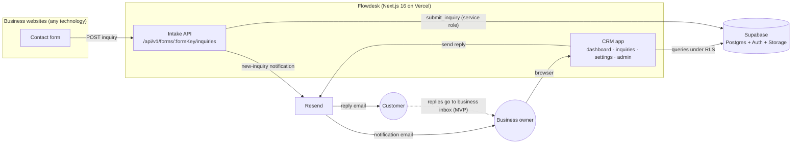

# Flowdesk: Architecture and Technical Implementation

| | |
|---|---|
| Audience | Developers working on Flowdesk |
| Related | [PRD.md](PRD.md) (what and why), [DB.md](DB.md) (database schema, RLS, functions) |
| Status | Agreed for MVP development. Code is at scaffold stage |
| Last updated | 2026-11-06 |

> **Before writing code:** this project uses **Next.js 16**, which differs from older versions. Read the relevant guide in `node_modules/next/dist/docs/` first (see `AGENTS.md`). The guides most relevant here:
> - `01-app/02-guides/authentication-with-cache-components.md`
> - `01-app/01-getting-started/16-proxy.md`
> - `01-app/01-getting-started/15-route-handlers.md`
> - `01-app/01-getting-started/07-mutating-data.md`
> - `01-app/03-api-reference/04-functions/after.md`
> - `01-app/03-api-reference/04-functions/refresh.md`

---

## 1. System overview

Flowdesk is **one Next.js application** on Vercel, backed by **one Supabase project per environment**. All businesses share the same application, database and deployment. Isolation comes from Postgres Row Level Security.



The system has two independent parts:
- **Business websites.** Their own design, technology and hosting. They only need to send an HTTP POST to the intake API with a form key.
- **Flowdesk.** It receives the inquiry, finds the source and business from the form key, stores the inquiry, and makes it available in that business's dashboard.

---

## 2. Technology stack

### 2.1 Already installed and configured

| Area | Package / tool | Version | Notes |
|---|---|---|---|
| Framework | `next` | 16.4.5 | App Router. `next.config.ts` enables `cacheComponents: true`, `partialPrefetching: true`, `experimental.agentFeedback`, and the Tailwind Turbopack loader for `*.css` |
| UI runtime | `react`, `react-dom` | 19.3.0 | |
| Language | TypeScript | ^5 | `strict: true`, path alias `@/*` → project root |
| Styling | `tailwindcss` v4, `@tailwindcss/turbopack`, `tw-animate-css` | ^4 | Config lives in CSS (`app/globals.css`); there is no `tailwind.config` file |
| Components | `shadcn` (CLI, dev dep) | ^4.23 | `components.json`: style **`base-luma`**, base color **`mist`**, CSS variables, RSC, icon library **Remix Icon**, menu color inverted, menu accent bold |
| Primitives | `@base-ui/react` | ^1.9 | The shadcn preset builds on Base UI (not Radix). Example: `components/ui/button.tsx` |
| Icons | `@remixicon/react` | ^4.9 | |
| Class utilities | `class-variance-authority`, `cn` | | `cn` is shadcn's compiled replacement for clsx + tailwind-merge (`lib/utils.ts` re-exports it) |
| Fonts | `next/font/google` | | Noto Sans → `--font-sans`, EB Garamond → `--font-heading`, Geist Mono → `--font-mono` (set in `app/layout.tsx`) |
| Supabase | `@supabase/ssr` ^0.12, `@supabase/supabase-js` ^2.119 | | Browser, server and proxy clients in `utils/supabase/` |
| Email | `resend` | ^6.37 | `utils/resend/client.ts`: lazy client plus a `sendEmail()` wrapper. The SDK supports `headers`, `bcc`, `replyTo`, `react` templates, `idempotencyKey`, and receiving (inbound) emails |
| Safety | `server-only` | | Marks server-only modules |
| Lint | ESLint 9 flat config | | `eslint-config-next` core-web-vitals + TypeScript |

**Developer tooling already set up:**
- `.mcp.json`:
  - **Supabase MCP**, bound to the dev project `zbpimhaqjuabdzjruxjd`
  - **shadcn MCP**, used to look up and add components (see `docs/ui-rules.md`)
- Agent skills in `.agents/skills/`: `supabase` and `supabase-postgres-best-practices`.

### 2.2 To add

| Package / tool | Type | Why |
|---|---|---|
| `supabase` (CLI) | dev dep | Migrations in `supabase/migrations`, `db push`, type generation |
| `zod` (v4) | dep | Validation for the intake API, server actions and search params. Schemas are shared by client and server |
| `@react-email/components` | dep | Reply and notification email templates as React components |
| `next-themes` | dep | Light/dark toggle (class strategy, matching `@custom-variant dark` in `globals.css`) |
| `vitest` | dev dep | Unit tests for pure logic (validation, origin matching, reply content, formatting) |
| shadcn components | via CLI/MCP | `sidebar`, `card`, `table`, `badge`, `input`, `textarea`, `label`, `field`, `select`, `tabs`, `dialog`, `alert-dialog`, `dropdown-menu`, `avatar`, `separator`, `skeleton`, `sonner`, `chart` (brings Recharts), `pagination`, `tooltip`, `breadcrumb`, `empty`, `spinner`. Check availability with the shadcn MCP first |

### 2.3 External services

| Service | Used for | Environments |
|---|---|---|
| **Vercel** | Hosting, preview deployments, logs | Preview → dev DB; Production → prod DB |
| **Supabase** | Postgres, Auth (email/password, invites), Storage (logos) | Dev: `zbpimhaqjuabdzjruxjd`. Prod: new project before launch |
| **Resend** | Reply emails, new-inquiry notifications, and Supabase Auth emails via SMTP | One account, with a separate API key per environment |

---

## 3. Next.js 16 conventions used in this project

| Topic | Rule |
|---|---|
| **Proxy** | `proxy.ts` (the Next 16 name for middleware) only **refreshes the Supabase session** and does **optimistic redirects** (no session → `/login`). It never does database lookups or real authorization. Its matcher excludes static assets **and `/api/v1/`**, so the public intake stays fast. |
| **Cache Components** | With `cacheComponents: true`, reading `cookies()`/`headers()` outside `<Suspense>` is a build error. Any component that reads the session sits **inside a `<Suspense>` boundary**. Static chrome (sidebar frame, headings) renders into the static shell; user data streams in. Never `await` the session at the top level of a layout. Push it into a child component behind a boundary. |
| **Escape hatch** | While building a route, `export const instant = false` may be used temporarily to let it block on the server. Remove it once the route follows the Suspense pattern. |
| **Data Access Layer (DAL)** | All session and membership reads go through `lib/dal.ts` (`server-only`). Pages, server actions and route handlers call the DAL; they never read cookies or query memberships directly. |
| **Caching tenant data** | **No server-side caching of tenant data** in the MVP (no `use cache` on inquiry, customer or message queries). This avoids cross-tenant cache mistakes; RLS queries are fast enough. The DAL uses React `cache()` for per-request de-duplication. `use cache: private` may later wrap the identity lookup only, to make navigations instant, but never the suspension check. |
| **Cache keys** | If `use cache` is ever used, keys and tags contain only stable ids, never emails or other personal data (keys are stored in plain text). |
| **Mutations** | Server Actions (`'use server'`) in `lib/actions/*`. Each one: (1) calls the DAL, (2) validates input with zod, (3) performs the write, (4) calls `refresh()` from `next/cache` so the client router shows fresh data, (5) returns `{ ok: true } \| { ok: false, error }`. Forms use `useActionState` for pending and error states. |
| **Background work** | `after()` from `next/server` for work that must not delay the response (new-inquiry notification email). |
| **Route props** | Use the global `PageProps<'/route'>` / `LayoutProps<'/route'>` helpers (already used in `app/layout.tsx`). `params` and `searchParams` are Promises. |
| **Prefetching** | `partialPrefetching` is on. Links to `/inquiries/[id]` from lists may use `prefetch={true}` where instant opening is worth one server call per link. |

---

## 4. Project structure (target)

```
app/
  layout.tsx                         Root: fonts, ThemeProvider, Toaster, metadata ("Flowdesk")
  page.tsx                           Landing page (static)
  (auth)/
    login/page.tsx
    forgot-password/page.tsx
    update-password/page.tsx         After a recovery link
    accept-invite/page.tsx           After an invite link: set name + password
  auth/confirm/route.ts              Exchanges token_hash (invite, recovery, email_change), then redirects
  suspended/page.tsx
  (app)/                             Owner area (sidebar shell)
    layout.tsx
    dashboard/page.tsx
    inquiries/page.tsx
    inquiries/[id]/page.tsx
    settings/layout.tsx              Tab navigation
    settings/page.tsx                Redirects to /settings/business
    settings/business/page.tsx
    settings/email/page.tsx
    settings/integration/page.tsx
    settings/account/page.tsx
  admin/
    layout.tsx                       Guard: requirePlatformAdmin()
    page.tsx                         Business list
    businesses/new/page.tsx
    businesses/[id]/page.tsx
  api/v1/forms/[formKey]/inquiries/route.ts   Public intake (POST, OPTIONS)
  form-result/page.tsx               Public fallback result page for plain HTML forms (§7.3)
components/
  ui/                                shadcn components (generated, do not hand-edit beyond variants)
  app/                               Owner-area components: app-sidebar, stat-card, inquiry-table,
                                     status-badge, timeline, reply-composer, code-snippet, …
  admin/                             Admin components
emails/
  reply-email.tsx                    Customer reply template
  new-inquiry-email.tsx              Owner notification template
  components/                        Shared email layout
lib/
  dal.ts                             getSession, requireUser, requireBusiness, requirePlatformAdmin
  actions/                           Server actions: auth.ts, inquiries.ts, replies.ts, settings.ts, admin.ts
  intake/                            schema.ts, origin.ts, rate-limit.ts, config.ts, respond.ts
  email/                             sender.ts, reply-content.ts, send-errors.ts, notify.ts, render.ts
  format.ts                          Date and time formatting in the business timezone
  queries/dashboard.ts               Dashboard reads (stats, chart, recent, needs attention, feed)
  time.ts                            requestTime(): the clock for server components, read only after a request-time API (§3)
  strings/en.ts                      All UI copy (English); ready for i18n later
  validation.ts                      Shared zod schemas (search params, settings forms)
  database.types.ts                  Generated by the Supabase CLI
  utils.ts                           (existing) cn
utils/
  supabase/client.ts                 (existing) browser client
  supabase/server.ts                 (existing) server client (cookies)
  supabase/middleware.ts             (existing, to fix) session refresh for proxy.ts
  supabase/admin.ts                  (new) secret-key client, server-only
  resend/client.ts                   (existing, to extend) Resend client + sendEmail
supabase/
  config.toml
  migrations/                        See DB.md §12
  seed.sql
  tests/rls.sql                      RLS isolation checks
scripts/
  seed-dev-users.ts                  Creates dev auth users through the Admin API
  dev-auth-link.ts                   Prints invite / recovery links without sending email (dev only)
  test-site/serve.ts                 Local test website on port 5500 (HTML + JavaScript forms), `npm run test-site`
proxy.ts                             (existing) calls the session refresh
docs/                                PRD.md, Tech.md, DB.md, ui-rules.md
```

---

## 5. Data access: Supabase clients and authorization

### 5.1 Clients

| Client | File | Key | RLS | Use for |
|---|---|---|---|---|
| Browser | `utils/supabase/client.ts` | Publishable | Yes | Logo upload to Storage only (direct upload). Everything else goes through the server |
| Server (user) | `utils/supabase/server.ts` | Publishable + user cookies | **Yes** | All owner reads, and owner writes allowed by RLS and grants (settings, `read_at`, deletes, status RPCs) |
| Proxy | `utils/supabase/middleware.ts` | Publishable + request cookies | Yes | Session refresh only |
| **Admin (new)** | `utils/supabase/admin.ts` | **`SUPABASE_SECRET_KEY`** | **Bypassed** | Only: (1) the intake route, (2) the `/admin` area, (3) **message writes** for replies (§9.2), (4) the notification job, (5) dev seeding |

```ts
// utils/supabase/admin.ts
import "server-only";
import { createClient } from "@supabase/supabase-js";
import type { Database } from "@/lib/database.types";

export const createAdminClient = () =>
  createClient<Database>(
    process.env.NEXT_PUBLIC_SUPABASE_URL!,
    process.env.SUPABASE_SECRET_KEY!,
    { auth: { persistSession: false, autoRefreshToken: false } },
  );
```

**Rules for the admin client:**
- Import it only from server-only modules.
- Never pass its results to the client unfiltered.
- Before every admin-client write on behalf of an owner, first **read the target row with the user client**. If RLS hides it, stop.
- Owner-facing values (recipient, sender, business) are derived **on the server** from database rows, never taken from client input.
- Code in `/admin` must never select from `customers`, `inquiries`, `messages` or `inquiry_events` (PRD ADM-7).

### 5.2 Why message writes use the admin client
Owners have no INSERT/UPDATE rights on `messages` (DB.md §8). If they could insert message rows through the public Data API, they could create rows with arbitrary recipients and then trigger a "retry" that sends platform email to anyone. Instead, the reply action:
1. verifies access with an RLS read of the inquiry
2. builds the message entirely on the server
3. writes it with the admin client

The `on_message_status` trigger keeps `answered_at` and the events consistent.

### 5.3 Data Access Layer (`lib/dal.ts`)

```ts
import "server-only";
import { cache } from "react";
import { cookies } from "next/headers";
import { redirect, notFound } from "next/navigation";
import { createClient } from "@/utils/supabase/server";

export const getSession = cache(async () => {
  const supabase = createClient(await cookies());
  const { data } = await supabase.auth.getClaims();
  if (!data?.claims) return null;
  return { supabase, userId: data.claims.sub, email: data.claims.email as string };
});

export async function requireUser() {
  const session = await getSession();
  if (!session) redirect("/login");
  return session;
}

// The owner's single business (MVP). Redirects if none or suspended.
export const requireBusiness = cache(async () => {
  const session = await requireUser();
  const { data: m } = await session.supabase
    .from("memberships")
    .select("role, business:businesses(*)")
    .limit(1)
    .maybeSingle();
  if (!m?.business) redirect((await isPlatformAdmin(session)) ? "/admin" : "/login?error=no_business");
  if (m.business.status === "suspended") redirect("/suspended");
  return { ...session, business: m.business, role: m.role };
});

export async function requirePlatformAdmin() {
  const session = await requireUser();
  if (!(await isPlatformAdmin(session))) notFound();
  return session;
}
```

`isPlatformAdmin` reads the caller's own row in `platform_admins` (an RLS policy allows `user_id = auth.uid()`).

**Every server action and route handler calls the DAL itself**, even if the page already did. Never rely on the UI having hidden a button.

### 5.4 Data isolation summary
- Postgres RLS on every table, using `private.active_business_ids()` (DB.md §7.1, §8).
- Column grants stop owners from changing protected fields: sender address, status, everything on inquiries except `read_at` (DB.md §8.3).
- Composite foreign keys make cross-tenant references impossible (DB.md §1).
- Suspended businesses: their tenant data is hidden at the RLS level, and the DAL redirects their owners to `/suspended`.

---

## 6. Authentication and onboarding

### 6.1 Supabase Auth configuration (dashboard, per environment)

| Setting | Value |
|---|---|
| Providers | Email only (password). No OAuth, no magic link |
| **Allow new users to sign up** | **Off**. Accounts are created only by admin invite. The Admin API still works |
| Confirm email | On |
| Password rules | Minimum length **8**, requirements **letters and digits** (zod enforces the same rule in the app) |
| Secure email change | **On**: the old and the new address must both confirm |
| Secure password change | **Off**: the app asks for the current password itself (§6.2) |
| Email link expiry (OTP expiration) | **86400 s (24 hours)**, shared by invite, reset and email change links. The admin can resend an invite |
| Sessions | No timebox or inactivity timeout. A session lasts until the user signs out |
| Bot protection | Supabase built-in rate limits only (no CAPTCHA) |
| Site URL | `NEXT_PUBLIC_APP_URL` |
| Redirect URLs | `http://localhost:3000/**`, `https://*-<team>.vercel.app/**` (dev project), `https://app.<domain>/**` (prod project) |
| SMTP | Resend: host `smtp.resend.com`, port 465, user `resend`, password = a Resend API key limited to sending. Sender `Flowdesk <auth@mail.<domain>>`. Before the domain exists, use Supabase's default mailer, which only delivers to the project team's addresses and is heavily rate-limited |
| Email templates | Flowdesk-branded. Links use the token-hash format below |

Email template links (hosted templates, set per environment):

| Template | Link |
|---|---|
| Invite user | `{{ .SiteURL }}/auth/confirm?token_hash={{ .TokenHash }}&type=invite&next=/accept-invite` |
| Reset password | `{{ .SiteURL }}/auth/confirm?token_hash={{ .TokenHash }}&type=recovery&next=/update-password` |
| Change email | `{{ .SiteURL }}/auth/confirm?token_hash={{ .TokenHash }}&type=email_change&next=/settings/account` |

### 6.2 Flows

| Flow | Implementation |
|---|---|
| **Sign in** | Server action → `supabase.auth.signInWithPassword`. Redirect to a validated `next` param (relative paths only) or `/dashboard`. Admins without a business go to `/admin` |
| **Sign out** | Server action → `supabase.auth.signOut({ scope: 'local' })` (this device only) → redirect `/login` |
| **Confirm link** | `app/auth/confirm/route.ts`: `supabase.auth.verifyOtp({ type, token_hash })`, then redirect to `next` (validated as a relative path). If only `?code=` is present (Supabase's default PKCE templates), it uses `exchangeCodeForSession(code)` instead. On error, redirect `/login?error=link_invalid`. After an `email_change` verification, if the change is still waiting for the other address, it redirects with `notice=email_change_partial` |
| **Accept invite** | `/accept-invite` (session already set by the confirm step): form for full name + password → `auth.updateUser({ password, data: { full_name } })` and update `profiles.full_name` → `/dashboard` |
| **Forgot password** | `auth.resetPasswordForEmail(email)`. Always shows "If an account exists, we sent a link" (no account enumeration) |
| **Update password** | `/update-password` → `auth.updateUser({ password })` |
| **Change login email** | Settings → Account → `auth.updateUser({ email })`. With Secure email change on, Supabase sends a link to each address; the change applies after both are confirmed |
| **Change password** | Settings → Account → current password + new password twice. The current password is verified with `signInWithPassword` on a throwaway supabase-js client (`persistSession: false`) so the user's cookies are untouched, then `auth.updateUser({ password })` on the user client |
| **Session refresh** | `proxy.ts` → `utils/supabase/middleware.ts` calls `supabase.auth.getClaims()` on every matched request and writes refreshed cookies |
| **Route protection** | Optimistic: the proxy redirects requests with no session on `/dashboard`, `/inquiries`, `/settings` and `/admin` to `/login?next=…`. Authoritative: the DAL in every page, action and route |

### 6.3 Admin onboarding (`lib/actions/admin.ts` → `createBusiness`)
1. Run `requirePlatformAdmin()` and validate the input with zod (business name, email, website, timezone, owner name, owner email).
2. Generate a unique `slug` from the name. Compute `sender_email = <slug>@<PLATFORM_SENDING_DOMAIN>` (see §9.1 for dev).
3. Call `admin.auth.admin.inviteUserByEmail(ownerEmail, { data: { full_name } })` to get the new user id.
4. Call `admin.rpc('create_business_with_owner', { p_owner_id, …, p_allowed_origins: [origin of website] })` (DB.md §7.2).
5. If step 4 fails, run `admin.auth.admin.deleteUser(userId)` to roll back the invite.
6. If the email already belongs to a user, show an error. Linking an existing user to a second business is a later feature.

**Resend invite:**
- Call `inviteUserByEmail` again for a user who hasn't accepted yet.
- If Supabase refuses, use `auth.admin.generateLink({ type: 'invite', email })` and send that link with Resend.
- Verify this during implementation.

**Future self-registration:** a `/register` page calls `auth.signUp` (with sign-ups enabled), then a server action calls `create_business_with_owner(…, p_status => 'pending')`. The DAL sends `pending` businesses to an "awaiting approval" page. No schema change is needed.

---

## 7. Public intake API

### 7.1 Endpoint

```
POST    {NEXT_PUBLIC_APP_URL}/api/v1/forms/{formKey}/inquiries
OPTIONS {NEXT_PUBLIC_APP_URL}/api/v1/forms/{formKey}/inquiries
```

The form key is in the **path**, so CORS preflight (`OPTIONS`) can check the request origin against that source's `allowed_origins`, and plain HTML forms need only an `action` URL. The route is versioned (`v1`) so the contract can change later without breaking connected websites.

### 7.2 Request

Accepted content types: `application/json`, `application/x-www-form-urlencoded`, `multipart/form-data`. Anything else returns 415.

| Field | Required | Rules |
|---|---|---|
| `name` | yes | Trimmed, 1–200 chars, no control characters |
| `email` | yes | Trimmed, valid email, ≤ 254 chars |
| `subject` | yes | Trimmed, 1–200 chars, **no line breaks** (prevents header injection) |
| `message` | yes | Trimmed, 1–5000 chars |
| `_hp` | no | Honeypot. Must be empty or absent. If filled, the submission is discarded silently |
| `_redirect` | no | Form posts only. An absolute URL whose origin is in `allowed_origins`. Success → `303` to this URL |
| `_error_redirect` | no | Same rule. Error → `303` to this URL with `?error=<code>` |

Unknown fields are ignored. Total body size is limited to **16 KB**.

### 7.3 Processing order (`app/api/v1/forms/[formKey]/inquiries/route.ts`)

| # | Step | Failure |
|---|---|---|
| 1 | Reject if `Content-Length` > 16 KB. Read the body with a 16 KB cap (covers a missing `Content-Length`) | `413 payload_too_large` |
| 2 | Parse the body by content type | `415 unsupported_media_type` / `400 invalid_body` |
| 3 | Look up the source by `formKey` (admin client), joined to the business. Requires `is_active` and business `status = 'active'` | `403 invalid_form_key` (the same code for unknown, inactive and suspended, so nothing is revealed) |
| 4 | Origin check: the `Origin` header, or the origin of `Referer` if `Origin` is missing, must exactly match one of `allowed_origins` | `403 origin_not_allowed` |
| 5 | Rate limit with `check_rate_limit` (DB.md §7.2): per source + IP hash, then per source | `429 rate_limited` + `Retry-After` |
| 6 | Honeypot: if `_hp` is non-empty, return the normal success response and store nothing | — |
| 7 | Validate the fields (zod, `lib/intake/schema.ts`) | `400 validation_failed` + `fields` |
| 8 | `admin.rpc('submit_inquiry', …)`, which creates or updates the customer, inserts the inquiry and logs the `received` event in one transaction | `500 server_error` (logged) |
| 9 | `after(() => notifyNewInquiry(inquiryId))` | Never affects the response |
| 10 | Respond `201` (or `303` in redirect mode, see below) | — |

**Redirect mode** is for plain HTML forms, where the browser expects a page and not JSON. A request is in redirect mode when it carries `_redirect` or `_error_redirect`, or when the browser says it is navigating (`Sec-Fetch-Mode: navigate`), or, if that header is missing, when `Accept` includes `text/html`. A JavaScript `fetch` is never in redirect mode unless it sends one of the two fields.
- **Success:** `303` to `_redirect` if it is valid, otherwise to Flowdesk's own `/form-result?status=success`.
- **Error:** `303` to `_error_redirect?error=<code>` if it is valid, otherwise to `/form-result?status=error&code=<code>` (plus `&fields=email,subject` for validation errors).
- `/form-result` is public. It shows messages chosen by code from `lib/strings/en.ts`, lists field names from a fixed list, never repeats submitted values, and offers a **Go back** button (`history.back()`, so the visitor's text is kept).

Defaults in `lib/intake/config.ts`. The two submission limits can be overridden with environment variables, so development can use looser values:

| Limit | Default (production) | Environment variable |
|---|---|---|
| Per source + IP hash | 5 submissions / 10 minutes | `INTAKE_LIMIT_PER_VISITOR` |
| Per source (all visitors) | 100 submissions / hour | `INTAKE_LIMIT_PER_SITE` |
| Body size | 16 KB | (fixed) |

The **IP hash** is `sha256(IP_HASH_SALT + ip)`. The IP is taken from the first value of `x-forwarded-for` (set by Vercel). The raw IP is never stored.

**About the origin check:**
- Browsers set `Origin` and scripts cannot fake it, so other websites cannot use a business's key from a browser.
- Non-browser clients (curl, servers) can set any `Origin`. Rate limits, validation and the honeypot are the controls for that case.
- Server-side integrations (e.g. a Next.js site posting from its own server) must send an `Origin` header equal to one of their allowed origins.

### 7.4 Responses

```jsonc
// 201 Created (also returned for honeypot hits, so bots can't tell the difference)
{ "ok": true }

// 4xx / 5xx
{
  "ok": false,
  "error": {
    "code": "validation_failed",
    "message": "Some fields are invalid.",
    "fields": { "email": "Enter a valid email address." }
  }
}
```

| Code | HTTP | Meaning |
|---|---|---|
| `invalid_body` | 400 | Body could not be parsed |
| `validation_failed` | 400 | Field errors in `fields` |
| `invalid_form_key` | 403 | Unknown or inactive key, or the business is not active |
| `origin_not_allowed` | 403 | Origin not in the source's allowed list |
| `payload_too_large` | 413 | Body over 16 KB |
| `unsupported_media_type` | 415 | Unsupported content type |
| `rate_limited` | 429 | Too many submissions; see `Retry-After` |
| `server_error` | 500 | Unexpected error (logged) |

**CORS:**
- When the origin is allowed, both `OPTIONS` and `POST` responses include:
  - `Access-Control-Allow-Origin: <origin>`
  - `Vary: Origin`
  - `Access-Control-Allow-Methods: POST, OPTIONS`
  - `Access-Control-Allow-Headers: Content-Type`
  - `Access-Control-Max-Age: 86400`
- When the origin is not allowed, there are no CORS headers, so the browser blocks the response.

### 7.5 Integration snippets (rendered in Settings → Integration, with the real key and URL)

Plain HTML:
```html
<form action="https://APP_URL/api/v1/forms/pk_XXXXXXXX/inquiries" method="POST">
  <label>Name <input name="name" required maxlength="200"></label>
  <label>Email <input name="email" type="email" required maxlength="254"></label>
  <label>Subject <input name="subject" required maxlength="200"></label>
  <label>Message <textarea name="message" required maxlength="5000"></textarea></label>

  <!-- Optional spam trap: leave it hidden and empty -->
  <input name="_hp" tabindex="-1" autocomplete="off" aria-hidden="true"
         style="position:absolute;left:-10000px">

  <input type="hidden" name="_redirect" value="https://YOUR-SITE/thank-you">
  <input type="hidden" name="_error_redirect" value="https://YOUR-SITE/contact-error">

  <p><small>We use your details only to respond to your inquiry.
     See our <a href="https://YOUR-SITE/privacy">privacy policy</a>.</small></p>
  <button type="submit">Send</button>
</form>
```

JavaScript (`fetch`):
```js
const res = await fetch("https://APP_URL/api/v1/forms/pk_XXXXXXXX/inquiries", {
  method: "POST",
  headers: { "Content-Type": "application/json" },
  body: JSON.stringify({ name, email, subject, message, _hp: honeypotValue }),
});
const data = await res.json();
if (!res.ok) {
  // data.error.code, data.error.fields
}
```

---

## 8. Email: sender identity and templates

### 8.1 Sender resolution (`lib/email/sender.ts`)

| Field | Production | Development (no `PLATFORM_SENDING_DOMAIN`) |
|---|---|---|
| From | `"{sender_name}" <{sender_email}>`. `sender_email` defaults to `{slug}@{PLATFORM_SENDING_DOMAIN}`, or an address on the business's `custom_sending_domain` once the admin verifies it in Resend | `"{sender_name}" <{RESEND_FROM_EMAIL}>` (`onboarding@resend.dev`, which only delivers to the Resend account owner's email) |
| Reply-To | `reply_to_email ?? email` | same |
| BCC | `email` if `bcc_replies` | same |

Until the domain exists, `create_business_with_owner` stores a placeholder `sender_email` (`{slug}@mail.flowdesk.invalid`). After the domain is verified, a one-off SQL update rewrites placeholder addresses.

Platform emails (new-inquiry notifications) are sent from `"Flowdesk" <notifications@{PLATFORM_SENDING_DOMAIN}>`, or from `RESEND_FROM_EMAIL` in dev.

### 8.2 Templates (`emails/`)
- **`reply-email.tsx`.** Business logo header (public URL of `logo_path`), or the business name when there is no logo, then the owner's text (line breaks kept), the signature, a divider, and "On {date}, {customer} wrote:" with the quoted original message. No Flowdesk footer: the email carries the business's identity. The plain-text version is built by `buildReplyText()` in `lib/email/reply-content.ts`, not by React Email's converter, so it is exactly what `messages.body_text` stores and "Show full email" displays. User text is rendered as text nodes and is never injected as raw HTML.
- **`new-inquiry-email.tsx`.** Flowdesk-branded. Customer name, subject, the first 300 characters of the message, the source name, the received time (business timezone) and an "Open in Flowdesk" button linking to `{APP_URL}/inquiries/{id}`.
- The default signature is `{owner full_name}\n{business name}`, used when `signature` is null.
- Dates come from `lib/format.ts` (`Intl.DateTimeFormat` with the business `timezone`).

### 8.3 `utils/resend/client.ts` changes
The existing `sendEmail()` wrapper should be extended:
- Add `bcc` and `headers` to `SendEmailOptions`. (Templates are rendered to HTML and plain text by `lib/email/render.ts` with `render()` from `@react-email/components`, so no `react` option is needed.)
- Accept a second `{ idempotencyKey }` argument and pass it to `resend.emails.send(payload, options)`.
- Keep returning Resend's `{ data, error }` unchanged.

---

## 9. Replies, history and retry

### 9.1 Statuses
| `messages.status` | Meaning | UI |
|---|---|---|
| `sending` | Row created; the provider call is in progress | Spinner |
| `sent` | Resend accepted the email (`sent_at`, `provider_message_id` set) | "Sent" |
| `failed` | Resend returned an error (`error_message` set) | "Failed: {friendly reason}" + **Retry** |

A `sending` row older than 2 minutes means the process died mid-send. It is shown as "Unknown: check before retrying" and offers Retry.

**One reply per inquiry (agreed 2026-11-08, PRD REP-11).** The partial unique index `messages_one_outbound_per_inquiry` (DB.md §9) allows one outbound message per inquiry, so two tabs or a double submit can never send twice. Follow-ups, with `In-Reply-To` / `References` threading, are planned (PRD §11.3); turning them on drops that index.

**Error reasons (agreed 2026-11-08, PRD REP-8).** `error_message` stores the provider's raw error as `"{name} ({statusCode}): {message}"` (`formatProviderError` in `lib/email/send-errors.ts`), and the failure is logged with ids only. The detail query maps it to a short, plain-language sentence with `describeSendError` on the server, so the raw text is never rendered. Resend's test-mode error names the Resend account's own address, which is one reason it is not shown.

### 9.2 Send reply (`lib/actions/replies.ts` → `sendReply`)
1. `requireBusiness()`. Validate `{ inquiryId, messageId, content }` with `replySchema` (content trimmed, 1–10,000 characters). `messageId` is a UUID generated by the composer when it mounts, so a double-submit hits the primary key and cannot send twice.
2. **RLS read** of the inquiry from `inquiries_view` with the user client (customer, subject, message, created_at, is_archived). Stop if it is not found or archived (archived inquiries are read-only).
3. Stop if the inquiry already has an outbound message (a friendly early check; the unique index is the real guard).
4. Build the email on the server:
   - **Recipient:** the inquiry's `customer_email`.
   - **Subject:** `replySubject()`: `Re: {subject}`, with line breaks removed and no second `Re:` when the subject already starts with one.
   - **Sender:** `resolveSender()` (§8.1).
   - **Body:** `buildReplyText()` gives the plain text (also stored as `body_text`), and `renderReplyEmail()` gives the HTML.
   - **Header:** `Message-ID: <{messageId}@{domain of the From address}>`. No `In-Reply-To` / `References` (no follow-ups yet).
5. Insert the `messages` row with the **admin client**: `status 'sending'`, `attempt_count 1`, `last_attempt_at`, `sent_by = userId`, and all snapshots. A unique violation (`23505`) means the inquiry already has a reply: stop without sending.
6. ``sendEmail(payload, { idempotencyKey: `${messageId}:1` })``. A thrown error counts as a failure.
7. Update the row with the admin client: `sent` + `sent_at` + `provider_message_id`, or `failed` + `error_message`. The DB trigger sets `answered_at` (first success) and inserts the `reply_sent` / `reply_failed` event (DB.md §7.4).
8. `refresh()` and return `{ ok: true }` or `{ ok: false, saved, error }`. Once the row is saved (sent or failed), the composer clears its text and draft and disappears (one reply per inquiry). Only when nothing was saved (validation, network, already replied) does it keep the text.

**Retry** (`retryMessage(messageId)`):
- Start with an RLS read of the message and its inquiry: the message must be `failed` or stale `sending`, and the inquiry must not be archived.
- **Claim** the attempt with one admin-client update that sets `status 'sending'`, `attempt_count = n + 1`, `last_attempt_at`, and the sender snapshots from the business's **current** settings (`from_name`, `from_email`, `reply_to_email`, `bcc_email`; agreed 2026-11-08, PRD REP-9). It only matches while `attempt_count` and `status` are still what was read, so a second click finds no row and stops.
- Resend the **stored** `subject`, `body_html`, `body_text`, recipient and `Message-ID`, with the current sender and idempotency key `${messageId}:${n + 1}`.
- Then update the status as in step 7 (`sent` also clears `error_message`).

Check during testing whether Resend keeps the custom `Message-ID` header. If it doesn't, follow-ups (later) will store Resend's id and use custom `X-Flowdesk-Message-Id` and `References` headers instead. Inbound routing does not depend on it, because it uses `reply_token` (§10).

### 9.3 Owner notification (`lib/email/notify.ts`)
Called inside `after()` from the intake route, using the admin client:
1. Load the inquiry, its business and its source.
2. Skip if `notify_new_inquiry` is false.
3. Send with `idempotencyKey: notify:{inquiryId}`.
4. Log errors with `console.error` (visible in Vercel logs).

Notifications are not stored in `messages`.

---

## 10. Future: inbound email sync (designed now, built later)

The goal is for customer replies from normal email clients to appear in the inquiry timeline. Nothing in the MVP schema needs to change for this:

1. Verify an inbound subdomain (e.g. `inbound.<domain>`) for **Resend Receiving** (the SDK already supports received emails and forwarding).
2. Change the reply-to for outbound replies to `reply+{inquiries.reply_token}@inbound.<domain>`. This is a change in `lib/email/sender.ts` only.
3. Add a webhook route `app/api/webhooks/resend/inbound/route.ts`:
   1. Verify the signature.
   2. Store the raw payload in `inbound_emails`.
   3. Resolve the inquiry by `reply_token` in the recipient address, falling back to `In-Reply-To`/`References` → `messages.rfc_message_id`.
   4. Insert a `messages` row (`direction 'inbound'`, `status 'received'`) with the parsed reply text as `content`.
   5. Forward a copy to the business email so their inbox still receives replies.
4. Add `customer_replied` to `inquiry_event_type` if the activity feed should show it.

Every outbound reply already carries its own `Message-ID` (§9.2), so a customer's reply can be matched to it before and after the switch.

---

## 11. Feature implementation notes

### 11.1 Owner app shell (`app/(app)/layout.tsx`)
- shadcn `Sidebar` with the Flowdesk logo, Dashboard, Inquiries (unread badge), Settings, the account dropdown (name, email, Sign out) and the theme toggle. On mobile it collapses to a sheet.
- The sidebar frame is static. The business name, user menu and unread count are server components inside `<Suspense>` with skeleton fallbacks. Each calls `requireBusiness()`, which is de-duplicated per request.
- The active-link highlight reads `usePathname()`, which is runtime data on dynamic routes such as `/inquiries/[id]`. `NavMain` therefore also sits inside a `<Suspense>`, whose fallback is the same links without a highlight (`NavMenu`). `SidebarInset` already renders the page's `<main>`, so page content goes in a `<div>`, not a second `<main>`.

### 11.2 Dashboard (`/dashboard`)
Each section is its own server component inside its own `<Suspense>` boundary, so the sections stream in independently:

| Section | Query |
|---|---|
| Stat cards | `rpc('get_dashboard_stats', { p_business_id })`. Each card links to `/inquiries?status=…` |
| 30-day chart | `rpc('get_inquiry_activity', { p_business_id, p_days: 30 })` → shadcn `chart` (bar) |
| Recent inquiries | `inquiries_view`, `archived_at is null`, order `created_at desc`, limit 5 |
| Needs attention | `inquiries_view`, `answered_at is null and archived_at is null`, order `created_at asc`, limit 5, plus a link to `/inquiries?status=unanswered&sort=asc` (oldest first, matching the card) |
| Activity feed | `inquiry_events` joined to `inquiries (subject, customer_name)`, order `created_at desc`, limit 10 |
| Empty state | When `total = 0`: a shadcn `Empty` linking to Settings → Integration |

### 11.3 Inquiry list (`/inquiries`)
- **Search params** (zod-parsed, invalid values fall back to defaults):
  - `status`: `all | new | awaiting | answered | unanswered | archived`, default `all` (non-archived)
  - `q`: search text
  - `sort`: `desc | asc`
  - `page`: from 1
- **Query:** `inquiries_view` with `{ count: 'exact' }` and `.range()` for 20 per page. Filters go on the base columns:
  - `new`: `answered_at is null and created_at > now−48h`
  - `awaiting`: `answered_at is null and created_at <= now−48h`
  - `answered`: `answered_at is not null`
  - `archived`: `archived_at is not null`
  - every other status: `archived_at is null`
- **Search:** ``.ilike('search_text', `%${escaped}%`)`` on the generated, trigram-indexed column. Escape `%`, `_`, `\` and commas.
- **Source names:** loaded once per request from `inquiry_sources` and mapped by `source_id`. The column is only shown when the business has more than one source.
- **UI (agreed 2026-11-07):**
  - shadcn `Table` from `lg` (1024px) up, with bold rows and a dot for unread inquiries. Below `lg` each inquiry is a stacked row (name, subject, status, date), reusing the dashboard's `InquiryRow`
  - Columns: Status (`Badge`), Customer (name, with the email beneath it), Subject, Website (only when the business has more than one source), Received
  - Status filter: `Tabs` from `lg` up and a `Select` below. No counts on the filters, only a result summary ("Showing 21–40 of 134")
  - Sort: a `Select` (Newest first / Oldest first) in the toolbar
  - Search: name, email and subject, debounced (300 ms). `%`, `_`, `\` and `,` match literally. A `*` still acts as a wildcard, because PostgREST reads it as `%` in `ilike` values and it cannot be escaped (harmless: the search only covers the owner's own rows). Typing replaces the history entry; filter, sort and page changes push one, so Back restores the view (LIST-7). Any filter, sort or search change resets the page to 1
  - Received: absolute, in the business timezone: "7 Nov, 14:32", with the year added when it is not the current year
  - Pagination: shadcn `Pagination` with Prev/Next and page numbers with "…" gaps. A page number past the end redirects to the last page
  - No row or bulk actions, no message preview. Each row links to `/inquiries/[id]?back=<list query>` (the `back` value is left out when the list view is the default one), so the detail page can return to the exact view (§11.4)
  - Empty states: no inquiries at all (the dashboard's empty state), no search match (with "Clear search"), no inquiries under a filter (with "Show all")

### 11.4 Inquiry detail (`/inquiries/[id]`)
- **Parallel queries:**
  - the inquiry from `inquiries_view`
  - its `messages` (asc)
  - its `inquiry_events` (asc)
  - the source name
- **Timeline:** messages (with status) merged with the non-message events (`marked_answered`, `marked_unanswered`, `archived`, `restored`) by time. `reply_sent` and `reply_failed` events are not repeated here because the message row shows its status; they appear in the dashboard feed.
- **Mark as read:** a small client component calls the `markRead` server action once on mount if the inquiry is unread. This avoids writing during render. "Mark as unread" sets `read_at = null`.
- **Actions** (server actions → RPCs from DB.md §7.3):
  - `mark_inquiry_answered`
  - `mark_inquiry_unanswered`, shown only when `answered_manually` and there is no sent message
  - `set_inquiry_archived`
  - delete inquiry: user client `.delete()` + `AlertDialog`, then redirect to `/inquiries`
  - delete customer: user client `.delete()` on `customers` (cascade) + `AlertDialog` that lists the number of inquiries to be deleted
- **Reply composer:** a `Textarea` with a character counter (max 10,000), Send disabled while pending or empty, toasts via `sonner`, and failed messages showing Retry.
- **UI (agreed 2026-11-08):**
  - **Scope:** the detail page is built in Phase 5 without the composer. The composer, Retry and the reply email come in Phase 6. Until then the composer slot is empty (no "coming soon" text), and a failed reply shows "Failed: {reason}" without a Retry button
  - **Layout:** two columns from `lg` up. Left: the original message, the timeline and (Phase 6) the composer. Right: the customer card and the details card (status, received time in the business timezone, website). One column below `lg`
  - **Thread:** the original message is the first card, each reply is a card below it, and status events (archived, restored, marked answered or unanswered) are thin one-line rows between them
  - **Replies in the timeline:** what the owner wrote, a status badge (Sent / Failed with the reason / Unknown if `sending` for over 2 minutes), the time, and a "Show full email" toggle that reveals the email as sent (`body_text`: signature and quoted original)
  - **Actions:** in the header. "Mark as answered" (while unanswered) and "Archive" / "Restore" are buttons. A "…" menu holds "Mark as unread", "Mark as unanswered" (only when `answered_manually` and no sent reply), and, set apart and in red, "Delete inquiry" and "Delete customer"
  - **Delete customer:** an `AlertDialog` that states what will be deleted (customer name, number of inquiries and replies). No typed confirmation
  - **After an action:** Archive keeps you on the page with an "archived" banner, a Restore button and a toast. Mark as unread goes back to the list with a toast. Deleting an inquiry or a customer goes back to the list with a toast
  - **Archived inquiries are read-only:** the composer, Retry and the answered / unanswered actions are hidden until the inquiry is restored
  - **No "other inquiries" list:** the detail page does not list the customer's other inquiries (removed 2026-11-08 at the owner's request; PRD DET-1 still mentions it). The customer's inquiries remain reachable by searching the list for their email
  - **Back link:** "← Inquiries" returns to the exact list view the owner came from. The list links carry the view in a `back` search param. The detail page rebuilds the link from the parsed params with `inquiriesHref()`, so a crafted value can never redirect anywhere except `/inquiries?…`
  - **Composer extras (Phase 6):** Ctrl/Cmd+Enter sends. A To / From / Subject line sits above the textarea. Below it, the business's actual signature is shown in muted text (agreed 2026-11-08), with a note that it and the customer's original message are added to the email. The draft is saved in the browser (`localStorage`, key `flowdesk:reply-draft:{inquiryId}`) if the owner leaves before sending. No confirmation dialog before sending
  - **Replies (agreed 2026-11-08):**
    - **One reply per inquiry.** The composer shows only while the inquiry is not archived and has no reply yet, including inquiries marked answered manually. Once a reply exists (sent or failed) the composer is gone. A failed reply is sent again only with its Retry button
    - **While sending:** the Send button shows a spinner and "Sending…", and the textarea is locked. The reply appears in the timeline when the provider answers (no optimistic insert)
    - **After sending:** a saved reply (sent or failed) clears the text and the draft, and a toast reports the result. Nothing saved (validation, network, already replied) keeps the text
    - **Retry** shows on failed and unknown replies, never on an archived inquiry. A failed reply cannot be discarded

### 11.5 Settings (`/settings/*`)
| Tab | Writes |
|---|---|
| Business | User client `update` on `businesses` (column grants allow only the permitted fields). The timezone `Select` is built from `Intl.supportedValuesOf('timeZone')`. **Logo:** the browser client uploads directly to Storage `business-logos/{business_id}/logo-{ts}.{ext}` (Storage RLS, 1 MB, png/jpeg/webp), then a server action saves `logo_path` and deletes the previous file |
| Email | **Built in Phase 6 with replies (agreed 2026-11-08).** `sender_name`, `reply_to_email`, `signature`, `bcc_replies`. The sender address is displayed read-only as the address customers actually see (`resolveSender()`, §8.1). An empty reply-to or signature is saved as `null` (use the default) |
| Integration | Read-only: each source's name, allowed origins, key (with a copy button), and the HTML/JS snippets from §7.5 built with `NEXT_PUBLIC_APP_URL` |
| Account | `profiles.full_name`; email change via `auth.updateUser({ email })`; password change via `auth.updateUser({ password })` |

**Tab bar (agreed 2026-11-08):** `app/(app)/settings/layout.tsx` shows the "Settings" heading and a tab bar with only the tabs that exist (Account and Email for now). Each tab is a link; the active one comes from `usePathname()`. The sidebar's Settings link still opens `/settings/account`.

### 11.6 Admin area (`/admin`)
- `app/admin/layout.tsx` calls `requirePlatformAdmin()`; every admin action calls it again.
- All queries use the admin client and only touch `businesses`, `memberships`, `profiles`, `inquiry_sources` and the Auth Admin API.
- **Pages:**
  - **List:** name, status badge, owner (name and email via `auth.admin.getUserById`), source count, created date.
  - **New:** the onboarding form (§6.3).
  - **Detail:** edit all business fields, including `sender_email`, `custom_sending_domain` and `status`.
    - Manage sources: add, rename, edit `allowed_origins` (validated as exact origins), toggle `is_active`, and rotate the key (`update … set public_key = default`, confirmed in a dialog).
    - Resend invite.
    - Suspend or reactivate (confirmed in a dialog).

### 11.7 Suspension
- RLS: `private.active_business_ids()` excludes suspended businesses, so their tenant data is not readable even through the API.
- The DAL: `requireBusiness()` redirects owners to `/suspended`.
- Intake: `submit_inquiry`, and the source lookup in step 3, reject suspended businesses with `403 invalid_form_key`.

---

## 12. UI implementation

- **Follow [ui-rules.md](ui-rules.md):**
  - use shadcn components first, checked and added via the shadcn MCP
  - use the `base-luma` preset from `components.json`, with Base UI primitives and Remix icons
  - style with Tailwind only
  - use shadcn variants instead of ad-hoc styles
- **Theme:** `next-themes` `ThemeProvider` with `attribute="class"`, `defaultTheme="system"`, and `suppressHydrationWarning` on `<html>`. A toggle in the sidebar footer and on the landing page.
- **Forms:** shadcn `Field` components, server actions with `useActionState`, and zod schemas shared between client and server. Errors are shown per field (`aria-invalid`, described-by), and success is confirmed with a toast.
- **Copy:** all UI strings live in `lib/strings/en.ts`. Components never hard-code user-facing text, which keeps i18n possible later.
- **States:** every data section has a skeleton fallback, an empty state (shadcn `Empty`) and an error boundary (`error.tsx` per route group).
- **Responsive:** sidebar → sheet on mobile. On narrow screens, tables become stacked rows with name, subject, status and date.
- **Accessibility:** keyboard-reachable actions, visible focus rings (from the preset), labelled inputs, sufficient contrast in both themes, and `AlertDialog` for destructive actions.
- **Metadata:** title template `%s · Flowdesk`, plus a favicon to replace the template one.

---

## 13. Configuration and environments

### 13.1 Environments

| Environment | App | Supabase | Resend | URL |
|---|---|---|---|---|
| Local | `npm run dev` | Dev project `zbpimhaqjuabdzjruxjd` | Dev API key; test sender until the domain exists | `http://localhost:3000` |
| Preview | Vercel preview deployments | Dev project | Dev API key | `*.vercel.app` |
| Production | Vercel production | **New prod project** | Prod API key | `https://app.<domain>` (domain to be purchased) |

### 13.2 Environment variables

| Variable | Scope | Status | Purpose |
|---|---|---|---|
| `NEXT_PUBLIC_SUPABASE_URL` | public | exists | Supabase project URL |
| `NEXT_PUBLIC_SUPABASE_PUBLISHABLE_KEY` | public | exists | Publishable (anon) key |
| `SUPABASE_SECRET_KEY` | server | **add** | Admin client (`utils/supabase/admin.ts`) |
| `RESEND_API_KEY` | server | exists | Resend sending |
| `RESEND_FROM_EMAIL` | server | exists | Dev fallback sender (`onboarding@resend.dev`) while there is no domain |
| `PLATFORM_NAME` | server | **add** | `Flowdesk` (email copy, notification sender name) |
| `PLATFORM_SENDING_DOMAIN` | server | **add** (empty until domain) | e.g. `mail.<domain>`, used for default sender addresses and `Message-ID`s |
| `NEXT_PUBLIC_APP_URL` | public | **add** | Absolute URLs in emails, auth redirects and integration snippets |
| `IP_HASH_SALT` | server | **add** | Random 32+ byte secret for IP hashing |
| `INTAKE_LIMIT_PER_VISITOR` | server | optional | Max submissions per visitor and source per 10 minutes. Default `5`; dev uses `100` |
| `INTAKE_LIMIT_PER_SITE` | server | optional | Max submissions per source per hour. Default `100`; dev uses `1000` |

`.env*` files are git-ignored (already in `.gitignore`). On Vercel, set Preview values to the dev project and Production values to the prod project.

### 13.3 Database workflow
1. `npx supabase init`, then `npx supabase link --project-ref zbpimhaqjuabdzjruxjd` (dev).
2. `npx supabase migration new <name>`, then write the SQL (order in DB.md §12).
3. Apply to dev: `npx supabase db push`.
4. Run the Supabase **advisors** (security + performance) and fix every warning.
5. Regenerate types: `npx supabase gen types typescript --project-id zbpimhaqjuabdzjruxjd > lib/database.types.ts`.
6. Seed dev: `supabase/seed.sql` + `scripts/seed-dev-users.ts`.
7. **Production:** link the prod project and `db push` the same migrations in a deliberate release step. Never seed prod. Never edit prod schema by hand.

Migrations are the only way the schema changes. The Supabase dashboard is for inspection and the one-off admin tasks described in the PRD (e.g. adding a `platform_admins` row).

### 13.4 Deployment
- Vercel project connected to the Git repo: `main` → Production, other branches → Preview.
- Runtime: Node.js (the default) for all routes, including the intake API.
- Before the first production deploy:
  - create the prod Supabase project and push the migrations
  - configure Auth (§6.1) and Storage
  - add the first `platform_admins` row
  - verify the Resend domain
  - set the env vars

---

## 14. Security checklist

| Area | Control |
|---|---|
| Tenant isolation | RLS on every table; `anon` revoked; composite FKs; column grants; advisors clean |
| Secrets | `SUPABASE_SECRET_KEY`, `RESEND_API_KEY` and `IP_HASH_SALT` are used only in `server-only` modules, never under a `NEXT_PUBLIC_` name |
| Authorization | DAL call at the top of every page, server action and route handler. Admin is guarded in the layout **and** in each action |
| Account creation | Supabase public sign-ups disabled; invite-only |
| Intake abuse | Origin allow-list, 16 KB limit, zod validation, optional honeypot, two rate limits, no reflection of submitted values in error messages |
| Email injection | Subject and name reject line breaks. Recipients and senders are derived on the server. Message rows are written only by the server |
| XSS | React escapes output. Email templates render user text as text nodes. No `dangerouslySetInnerHTML` with user content |
| Open redirects | `next`, `_redirect` and `_error_redirect` are validated (relative path, or origin in the allow-list) |
| Privacy | IPs are stored only as salted hashes. No personal data in cache keys or logs. Customer and inquiry deletes are hard deletes |
| Auth hardening | Supabase built-in rate limits on auth endpoints; generic responses on password reset |

---

## 15. Testing and verification

| Level | What | How |
|---|---|---|
| Unit | Intake schema, origin matching, redirect validation, sender resolution, reply subject and plain text, send-error mapping, date formatting, search escaping | Vitest (`*.test.ts` next to the module) |
| Database / RLS | Owner A cannot select, update or delete any row of business B in any table. Suspended owners see no tenant data. Owners cannot update protected columns or insert messages. Service-only RPCs are not executable by `authenticated` | `supabase/tests/rls.sql`, run against dev inside `begin … rollback`, impersonating users with `set local role authenticated` + `set_config('request.jwt.claims', '{"sub":"<uuid>","role":"authenticated"}', true)` |
| Advisors | No security or performance warnings | Supabase advisors after every migration |
| Manual E2E | The checklist below | Local dev + a test HTML page served on `localhost:5500` |
| Later | Browser E2E | Playwright |

**Manual end-to-end checklist:**
- **Onboarding:**
  - Admin creates a business; the invite arrives.
  - The owner sets a password, lands on the dashboard and sees the empty state.
- **Intake:**
  - The HTML snippet submits and redirects to the thank-you page.
  - The JS snippet gets `201`.
  - Wrong origin → `403`. Bad key → `403`. Body over 16 KB → `413`. Burst → `429`.
  - Filled honeypot → `201` and nothing stored. A form without a honeypot is accepted.
- **Notification:** the business email receives the new-inquiry email when the toggle is on, and nothing when it is off.
- **Status rules:**
  - New < 48h.
  - A seeded inquiry backdated to 49h shows Awaiting.
  - Mark answered → Answered; undo works.
  - An archived inquiry disappears from counts and the chart, and restore brings it back.
- **Replies:**
  - A send to the Resend account email → Sent, and the inquiry becomes Answered.
  - A forced failure (invalid from-domain) → Failed with the reason; Retry → Sent.
  - The BCC copy arrives when enabled.
  - The signature and quoted original appear.
  - A second send on the same inquiry (two tabs) is refused: one reply per inquiry.
  - Archived inquiry: no composer and no Retry.
- **Isolation:** signed in as owner B, opening owner A's inquiry URL → not found. A direct supabase-js query with B's session returns no A rows.
- **Suspension:** the owner is redirected to `/suspended`; intake → `403`; reactivating restores access.
- **Deletes:** deleting a customer removes all their inquiries and messages; the dashboard updates.
- **Auth:**
  - Forgot password → reset works.
  - Logged-out `/dashboard` → `/login`.
  - A non-admin on `/admin` → 404.
  - Changing the login email requires confirmation.
- **Quality:** `npm run lint` and `npm run build` pass. Mobile width is usable. Both themes are readable.

---

## 16. Current scaffold: gaps to fix first

| # | Gap | Fix |
|---|---|---|
| 1 | `utils/supabase/middleware.ts` creates a client but never calls `auth.getClaims()`, so **sessions are not refreshed** and routes are not protected | Call `await supabase.auth.getClaims()` right after creating the client (no code in between), make `proxy()` async, add the optimistic redirect for protected prefixes, and exclude `api/v1` from the matcher |
| 2 | No secret-key admin client | Add `utils/supabase/admin.ts` (§5.1) and `SUPABASE_SECRET_KEY` |
| 3 | `app/page.tsx` is the Next.js template; metadata says "Create Next App" | Replace with the Flowdesk landing page and metadata |
| 4 | `app/layout.tsx` loads Geist Sans, but `font-sans` resolves to Noto Sans | Remove the unused Geist Sans import |
| 5 | `sendEmail()` lacks `bcc`, `headers`, `react` and idempotency options | Extend it as in §8.3 |
| 6 | No `supabase/` folder; the database is empty | Follow §13.3 and DB.md §12 |
| 7 | Missing env vars: `SUPABASE_SECRET_KEY`, `PLATFORM_NAME`, `PLATFORM_SENDING_DOMAIN`, `NEXT_PUBLIC_APP_URL`, `IP_HASH_SALT` | Add to `.env.local` and Vercel |
| 8 | Only the `button` shadcn component is installed | Add the components from §2.2 as needed |

---

## 17. Implementation phases

| Phase | Scope | Done when |
|---|---|---|
| 0 | Foundations: read the Next 16 docs, fix gaps 1–5, add the packages (§2.2), Supabase CLI setup, app shell with sidebar and theme toggle | The app runs, a session refreshes, the shell renders in both themes |
| 1 | Database: migrations per DB.md, advisors clean, generated types, dev seed, RLS tests | `supabase/tests/rls.sql` passes |
| 2 | Auth: login, logout, forgot/update password, confirm route, accept invite, route protection, Auth dashboard config | All auth flows work end-to-end |
| 3 | Admin area: list, onboarding, sources and keys, sender settings, suspension | A business can be onboarded without SQL |
| 4 | Intake API, owner notification, local test website. **The Integration settings tab is deferred** and built in a later round | All intake checklist items pass |
| 5 | Inquiry list and detail: filters, search, pagination, read/unread, mark answered, archive, deletes, timeline | List and detail checklist items pass |
| 6 | Replies (one per inquiry): template, send, history, failure, retry, BCC, signature, plus the Email settings tab (moved here from Phase 8, agreed 2026-11-08) | Reply checklist items pass |
| 7 | Dashboard: stats, chart, recent, needs attention, activity feed | Dashboard matches the seeded data |
| 8 | Settings: business (with logo), account. (Email was built in Phase 6.) | Settings checklist items pass |
| 9 | Polish and launch: responsive and empty/loading/error states, landing page, prod project, Resend domain and SMTP, Vercel env, first admin | Full manual checklist passes on production |
